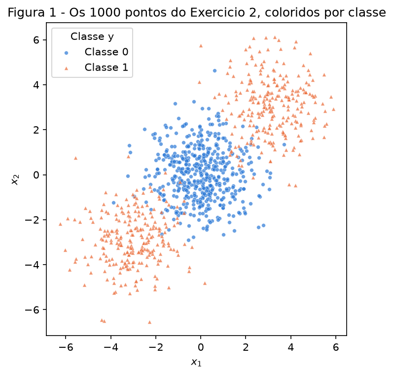
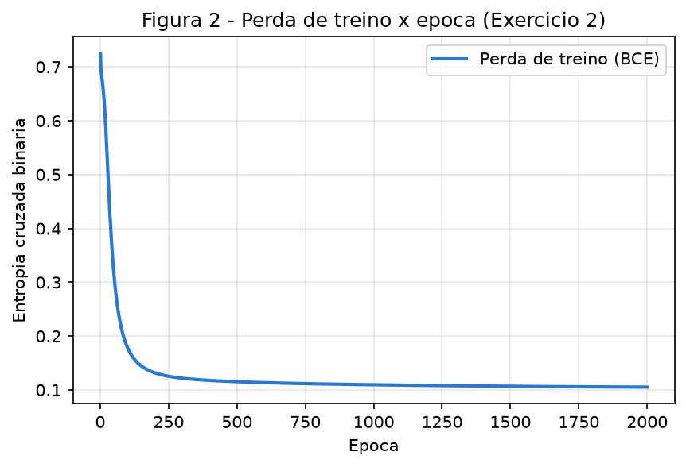
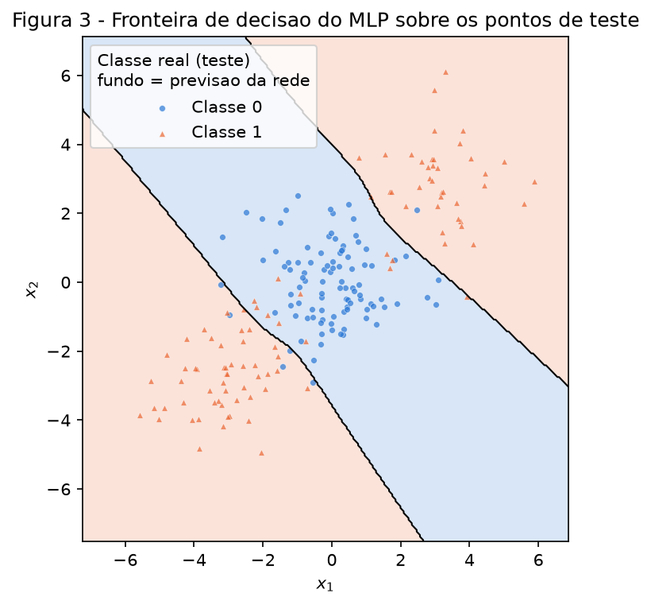
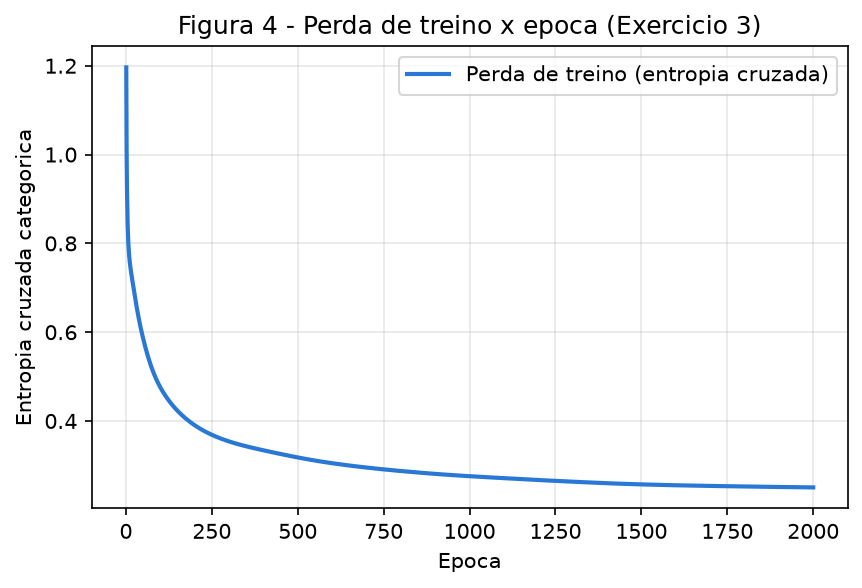
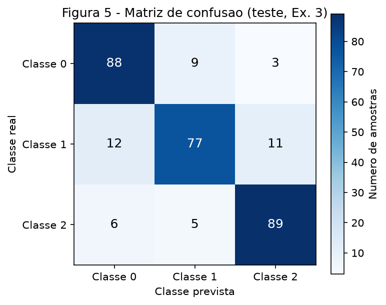
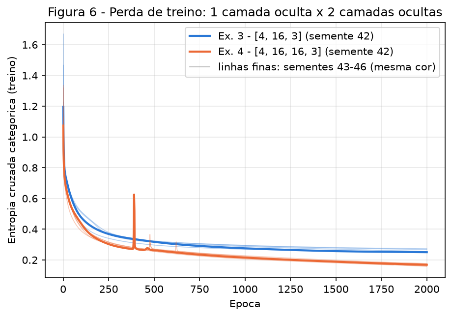

# 3. MLP

!!! abstract "Enunciado"

    [Exercises → MLP](https://insper.github.io/ann-dl/){:target='_blank'} — edição 2026.2.

Todo o código está em [`code/`](https://github.com/lucasnov/neural-networks-and-deep-learning/tree/main/docs/exercises/mlp/code)
e entra neste relatório direto dos arquivos. O MLP fica num arquivo só, `mlp.py`, usado
sem nenhuma alteração pelos Exercícios 2, 3 e 4. As bibliotecas são as permitidas:
NumPy para a rede, matplotlib para as figuras e scikit-learn só para gerar e dividir os
dados, para a linha de base e para a matriz de confusão.

A semente é `SEED = 42` em todos os scripts: `rng = np.random.default_rng(42)` sorteia os
pesos iniciais e `random_state=42` vai para o `make_blobs`, o `make_classification` e o
`train_test_split`. Tudo pode ser regenerado de uma vez a partir da raiz do repositório:

``` shell
python docs/exercises/mlp/code/run_all.py
```

Esse comando leva menos de um minuto, recria as seis figuras e imprime a mesma tabela de
"Resumo dos resultados" do fim desta página. Rodei duas vezes e os números foram
idênticos.

``` { .python .select linenums='1' title="docs/exercises/mlp/code/common.py" }
--8<-- "docs/exercises/mlp/code/common.py"
```

---

## Exercício 1

Rede 2 → 2 → 1 com $\tanh$ nas duas camadas e perda $L = (y - \hat y)^2$. Fiz a conta
abaixo à mão, carregando os valores sem arredondar entre um passo e outro e mostrando
4 casas. Valores do enunciado:

$$
\mathbf{x} = \begin{bmatrix} 0.5 \\ -0.2 \end{bmatrix},\quad y = 1.0,\quad
\mathbf{W}^{(1)} = \begin{bmatrix} 0.3 & -0.1 \\ 0.2 & 0.4 \end{bmatrix},\quad
\mathbf{b}^{(1)} = \begin{bmatrix} 0.1 \\ -0.2 \end{bmatrix},\quad
\mathbf{W}^{(2)} = \begin{bmatrix} 0.5 & -0.3 \end{bmatrix},\quad
b^{(2)} = 0.2,\quad \eta = 0.3
$$

### A — Passagem direta

**Pré-ativações da camada oculta**, $\mathbf{z}^{(1)} = \mathbf{W}^{(1)}\mathbf{x} + \mathbf{b}^{(1)}$:

$$
\begin{aligned}
z^{(1)}_1 &= 0.3 \cdot 0.5 + (-0.1)(-0.2) + 0.1 = 0.15 + 0.02 + 0.1 = 0.2700 \\
z^{(1)}_2 &= 0.2 \cdot 0.5 + 0.4 \cdot (-0.2) - 0.2 = 0.10 - 0.08 - 0.2 = -0.1800
\end{aligned}
$$

**Ativações da camada oculta**, $\mathbf{h}^{(1)} = \tanh(\mathbf{z}^{(1)})$:

$$
h^{(1)}_1 = \tanh(0.2700) = 0.2636, \qquad h^{(1)}_2 = \tanh(-0.1800) = -0.1781
$$

**Pré-ativação de saída**, $u^{(2)} = \mathbf{W}^{(2)}\mathbf{h}^{(1)} + b^{(2)}$:

$$
u^{(2)} = 0.5 \cdot 0.2636 + (-0.3)(-0.1781) + 0.2 = 0.1318 + 0.0534 + 0.2 = 0.3852
$$

**Saída e perda:**

$$
\hat y = \tanh(0.3852) = 0.3672, \qquad L = (1.0 - 0.3672)^2 = 0.6328^2 = 0.4004
$$

A rede começa prevendo 0.3672 para um alvo 1.0, então a perda é alta.

### B — Passagem reversa

Regra da cadeia, da saída para a entrada. A derivada da $\tanh$ é
$\tanh'(u) = 1 - \tanh^2(u)$, e como $\tanh(u)$ já foi calculado no forward, uso o próprio
valor da ativação: $1 - \hat y^2$ na saída e $1 - (h^{(1)}_i)^2$ na camada oculta.

**Derivada da perda em relação à saída:**

$$
\frac{\partial L}{\partial \hat y} = -2(y - \hat y) = 2(\hat y - y) = 2(0.3672 - 1.0) = -1.2655
$$

**Através da $\tanh$ da saída:**

$$
\frac{\partial \hat y}{\partial u^{(2)}} = 1 - \hat y^2 = 1 - 0.3672^2 = 0.8651
\qquad\Rightarrow\qquad
\delta^{(2)} = \frac{\partial L}{\partial u^{(2)}} = \frac{\partial L}{\partial \hat y}\cdot\frac{\partial \hat y}{\partial u^{(2)}} = -1.2655 \cdot 0.8651 = -1.0948
$$

**Camada de saída.** Como $u^{(2)} = W^{(2)}_1 h^{(1)}_1 + W^{(2)}_2 h^{(1)}_2 + b^{(2)}$, temos
$\partial u^{(2)}/\partial W^{(2)}_i = h^{(1)}_i$ e $\partial u^{(2)}/\partial b^{(2)} = 1$:

$$
\frac{\partial L}{\partial \mathbf{W}^{(2)}} = \delta^{(2)}\,\mathbf{h}^{(1)\top}
= -1.0948 \cdot \begin{bmatrix} 0.2636 & -0.1781 \end{bmatrix}
= \begin{bmatrix} -0.2886 & 0.1950 \end{bmatrix},
\qquad
\frac{\partial L}{\partial b^{(2)}} = \delta^{(2)} \cdot 1 = -1.0948
$$

**Propagando de volta.** $\partial u^{(2)}/\partial h^{(1)}_i = W^{(2)}_i$, então:

$$
\frac{\partial L}{\partial \mathbf{h}^{(1)}} = \delta^{(2)}\,\mathbf{W}^{(2)\top}
= -1.0948 \cdot \begin{bmatrix} 0.5 \\ -0.3 \end{bmatrix}
= \begin{bmatrix} -0.5474 \\ 0.3284 \end{bmatrix}
$$

Depois, pela $\tanh$ da camada oculta ($\odot$ = produto elemento a elemento):

$$
1 - (\mathbf{h}^{(1)})^2 = \begin{bmatrix} 1 - 0.2636^2 \\ 1 - (-0.1781)^2 \end{bmatrix} = \begin{bmatrix} 0.9305 \\ 0.9683 \end{bmatrix}
\qquad\Rightarrow\qquad
\boldsymbol\delta^{(1)} = \frac{\partial L}{\partial \mathbf{z}^{(1)}}
= \begin{bmatrix} -0.5474 \cdot 0.9305 \\ 0.3284 \cdot 0.9683 \end{bmatrix}
= \begin{bmatrix} -0.5094 \\ 0.3180 \end{bmatrix}
$$

**Camada oculta.** $z^{(1)}_i = W^{(1)}_{i1}x_1 + W^{(1)}_{i2}x_2 + b^{(1)}_i$, então
$\partial z^{(1)}_i/\partial W^{(1)}_{ij} = x_j$ e o gradiente é o produto externo do delta
com a entrada:

$$
\frac{\partial L}{\partial \mathbf{W}^{(1)}} = \boldsymbol\delta^{(1)}\mathbf{x}^\top
= \begin{bmatrix} -0.5094 \\ 0.3180 \end{bmatrix}\begin{bmatrix} 0.5 & -0.2 \end{bmatrix}
= \begin{bmatrix} -0.2547 & 0.1019 \\ 0.1590 & -0.0636 \end{bmatrix},
\qquad
\frac{\partial L}{\partial \mathbf{b}^{(1)}} = \boldsymbol\delta^{(1)} = \begin{bmatrix} -0.5094 \\ 0.3180 \end{bmatrix}
$$

### C — Atualização dos parâmetros

Regra: $\theta \leftarrow \theta - \eta\,\partial L/\partial\theta$, com $\eta = 0.3$.

| Parâmetro | Antes | Gradiente | Conta | Depois |
|-----------|-------|-----------|-------|--------|
| $W^{(2)}_1$ | 0.5000 | −0.2886 | $0.5 - 0.3(-0.2886)$ | **0.5866** |
| $W^{(2)}_2$ | −0.3000 | 0.1950 | $-0.3 - 0.3(0.1950)$ | **−0.3585** |
| $b^{(2)}$ | 0.2000 | −1.0948 | $0.2 - 0.3(-1.0948)$ | **0.5284** |
| $W^{(1)}_{11}$ | 0.3000 | −0.2547 | $0.3 - 0.3(-0.2547)$ | **0.3764** |
| $W^{(1)}_{12}$ | −0.1000 | 0.1019 | $-0.1 - 0.3(0.1019)$ | **−0.1306** |
| $W^{(1)}_{21}$ | 0.2000 | 0.1590 | $0.2 - 0.3(0.1590)$ | **0.1523** |
| $W^{(1)}_{22}$ | 0.4000 | −0.0636 | $0.4 - 0.3(-0.0636)$ | **0.4191** |
| $b^{(1)}_1$ | 0.1000 | −0.5094 | $0.1 - 0.3(-0.5094)$ | **0.2528** |
| $b^{(1)}_2$ | −0.2000 | 0.3180 | $-0.2 - 0.3(0.3180)$ | **−0.2954** |

A tabela tem nove linhas porque $\mathbf{W}^{(1)}$ tem quatro entradas. Em forma de matriz:

$$
\mathbf{W}^{(1)} = \begin{bmatrix} 0.3764 & -0.1306 \\ 0.1523 & 0.4191 \end{bmatrix},\quad
\mathbf{b}^{(1)} = \begin{bmatrix} 0.2528 \\ -0.2954 \end{bmatrix},\quad
\mathbf{W}^{(2)} = \begin{bmatrix} 0.5866 & -0.3585 \end{bmatrix},\quad
b^{(2)} = 0.5284
$$

**A perda desceria numa segunda passagem direta.** Cada parâmetro andou no sentido oposto
ao seu gradiente, que é a direção em que $L$ diminui. Dá para ver isso no sinal: como
$\hat y < y$, $\delta^{(2)}$ é negativo, então $b^{(2)}$ e o peso ligado a $h^{(1)}_1 > 0$
aumentaram e o peso ligado a $h^{(1)}_2 < 0$ ficou mais negativo. Todas essas mudanças
aumentam $u^{(2)}$ e, portanto, $\hat y$, puxando a saída para perto de 1. Com uma
amostra só e saída $\tanh$ (que nunca passa de 1), não há como o passo "passar do alvo".
Para conferir, repeti a passagem direta com os parâmetros novos: $\hat y$ vai de 0.3672
para 0.7112 e $L$ cai de 0.4004 para **0.0834**.

O script abaixo não faz parte da resolução: ele só confere os números acima, uma vez em
Python puro e outra pela classe `MLP` usada nos próximos exercícios (com os pesos do
enunciado colocados à mão). Os dois batem com a conta até a última casa.

??? example "Conferência — `exercise1_check.py`"

    ``` { .python .select linenums='1' title="docs/exercises/mlp/code/exercise1_check.py" }
    --8<-- "docs/exercises/mlp/code/exercise1_check.py"
    ```

---

## Exercício 2

### A — Gere os dados

Gerei os dados exatamente com o código do enunciado: `make_blobs` com centros
$(0,0)$, $(3,3)$, $(-3,-3)$, 500/250/250 pontos, `cluster_std=1.2` e `random_state=42`.
A Classe 0 é o grupo central e a Classe 1 são os dois grupos das pontas, 500 pontos de
cada. O split é `train_test_split(..., test_size=0.2, random_state=42, stratify=y)`:
800 pontos de treino e 200 de teste, 100 de cada classe no teste.


/// caption
**Figura 1** — Os 1000 pontos. A Classe 1 (triângulos) aparece nos dois lados da Classe 0
(círculos), ao longo da diagonal. Há alguma sobreposição nas bordas entre os grupos.
///

### B — Estabeleça a linha de base

Ajustei uma `LogisticRegression` do scikit-learn no treino. Acurácia no teste:
**0.4750** (47.5%), pior que chutar. No treino ela fica em 52.75%.

### C — Implemente o MLP

A rede está em `mlp.py`, escrita com NumPy:

- **Passagem direta**: para cada camada, $Z = XW^\top + b$ (o $\mathbf{z} = W\mathbf{x} + \mathbf{b}$ do
  Exercício 1, aplicado a todas as amostras de uma vez, uma por linha). Camadas ocultas
  usam $\tanh$; a saída usa a ativação que forma par com a perda.
- **Perda**: entropia cruzada binária com saída sigmoide,
  $L = -\frac1N\sum[y\log\hat y + (1-y)\log(1-\hat y)]$. Aplico `clip` em $\hat y$ para
  nunca calcular $\log 0$, e a sigmoide usa uma fórmula estável para não estourar o `exp`.
- **Passagem reversa**: começa com $\delta = \partial L/\partial u$ da saída, que para
  sigmoide + BCE vale $(\hat y - y)/N$. Em cada camada, $\partial L/\partial W = \delta^\top H_{\text{ant}}$
  e $\partial L/\partial b = \sum \delta$; depois o delta volta pela matriz de pesos e pela
  derivada da $\tanh$: $\delta_{\text{ant}} = (\delta W) \odot (1 - H_{\text{ant}}^2)$. É a
  mesma conta do Exercício 1, em forma de matriz.
- **Atualização**: $W \leftarrow W - \eta\,\partial L/\partial W$ e o mesmo para $b$.

Os tamanhos das camadas são um argumento (`MLP([2, 8, 1], ...)`), então o mesmo código
monta redes com qualquer número de camadas. Os pesos iniciais são sorteados com
$\mathcal N(0, 1/n_{\text{entrada}})$ (inicialização de Xavier), que mantém as
pré-ativações perto de zero, onde a $\tanh$ ainda tem derivada grande; os biases começam
em zero. O treino é gradiente descendente em lote completo: a cada época, uma passagem
direta com os 800 pontos, o cálculo da perda, a passagem reversa e uma atualização.

Para conferir a passagem reversa, comparei os gradientes da classe com diferenças finitas
($[L(\theta+\varepsilon) - L(\theta-\varepsilon)]/2\varepsilon$) nas três perdas, inclusive
numa rede com três camadas ocultas. O maior erro relativo foi da ordem de $10^{-8}$, ou
seja, os gradientes estão certos. Esse teste foi só um teste interno e não está no código
entregue.

``` { .python .select linenums='1' title="docs/exercises/mlp/code/mlp.py" }
--8<-- "docs/exercises/mlp/code/mlp.py"
```

**Configuração e resultado:**

| Item | Valor |
|------|-------|
| Arquitetura | `[2, 8, 1]`: 2 entradas → 8 neurônios $\tanh$ → 1 saída sigmoide (33 parâmetros) |
| Perda | entropia cruzada binária |
| Taxa de aprendizado | $\eta = 0.5$ |
| Épocas | 2000 (lote completo, 800 amostras) |
| Perda de treino | 0.7248 na 1ª época → 0.1051 na última |
| Acurácia no treino | 0.9675 |
| **Acurácia no teste** | **0.9150** |

Não fiz busca de hiperparâmetros. Testei rapidamente 4 ou 8 neurônios com $\eta = 0.1$ ou
$0.5$, e todas as combinações ficaram entre 91.5% e 93% no teste. Fiquei com uma delas sem
escolher a melhor pelo teste, que serve só para a avaliação final. Não padronizei as
entradas porque as duas features já estão na mesma escala (entre −7 e 7).


/// caption
**Figura 2** — Perda de treino × época. Cai rápido nas primeiras ~150 épocas, quando a rede
encontra as duas fronteiras, e depois desce devagar até 0.1051.
///


/// caption
**Figura 3** — Fronteira de decisão, obtida avaliando a rede numa grade de 300 × 300
pontos. Fundo azul = rede prevê Classe 0, fundo laranja = Classe 1. Os pontos são os 200
do teste, com a classe real.
///

``` { .python .select linenums='1' title="docs/exercises/mlp/code/exercise2_binary.py" }
--8<-- "docs/exercises/mlp/code/exercise2_binary.py"
```

### D — Análise

Na Figura 3, a região que a rede atribui à Classe 0 é uma **faixa diagonal** que atravessa
o plano do canto superior esquerdo ao inferior direito, presa entre duas fronteiras quase
paralelas. A Classe 1 fica com **duas regiões separadas**, uma acima e à direita da faixa
e outra abaixo e à esquerda. Ou seja: a região da Classe 1 não é conexa e cerca a Classe 0
pelos dois lados.

Uma reta divide o plano em só dois semiplanos, e cada lado é uma região única. Ela pode
separar a Classe 0 de um dos grupos da Classe 1, mas o outro grupo fica obrigatoriamente
do mesmo lado da Classe 0. Como os dois grupos da Classe 1 estão em posições simétricas em
relação à Classe 0 e as classes têm o mesmo tamanho, nenhuma inclinação ganha da outra. A
regressão logística acabou numa reta que praticamente não decide nada: os pesos ficaram
em 0.0296 e 0.0015 (quase zero) e a probabilidade prevista para a Classe 1 no teste ficou
toda entre 0.457 e 0.544. Com uma reta tão perto de "metade/metade", o resultado é um
cara ou coroa, e o 47.5% no teste (52.75% no treino) é só o ruído desse chute ficando um
pouco abaixo de 50%.

O MLP passa de 90% porque cada neurônio oculto traça a sua própria reta, e a camada de
saída combina essas retas. Duas delas, paralelas à diagonal, já bastam para montar a faixa
da Figura 3 (entre as duas retas = Classe 0, além de qualquer uma delas = Classe 1). Os 8.5% de erro
restantes estão nas bordas da faixa, onde as nuvens se sobrepõem (dá para ver na Figura 1)
e nenhuma fronteira acertaria todos os pontos.

---

## Exercício 3

### A — Gere os dados

`make_classification` com os parâmetros do enunciado: 1500 amostras, 4 features
informativas, 3 classes, 2 grupos por classe, `class_sep=1.0`, `random_state=42`. Split
80/20 com `random_state=42` e `stratify=y`: 1200 de treino e 300 de teste (100 por classe).

### B — Adapte a rede

**Nenhuma linha de `mlp.py` mudou.** O Exercício 3 usa a mesma classe `MLP` e a mesma função
`train` do Exercício 2. O que muda são só os argumentos:

| | Exercício 2 | Exercício 3 |
|---|---|---|
| `layer_sizes` | `[2, 8, 1]` | `[4, 16, 3]` |
| `loss` | `BinaryCrossEntropy` (saída sigmoide) | `CategoricalCrossEntropy` (saída softmax) |
| Alvo `Y` | coluna (N, 1) com 0/1 | one-hot (N, 3) |

A camada de saída passa a ter 3 unidades, a softmax transforma as 3 saídas em
probabilidades e a entropia cruzada categórica substitui a binária. A softmax subtrai o
máximo de cada linha antes do `exp` (o resultado é o mesmo, mas não estoura).

O motivo de a passagem reversa não precisar mudar é a derivada abaixo.

**Derivada de $\partial L/\partial u$ para softmax + entropia cruzada.** Para uma amostra,
com saídas $u_1,\dots,u_K$, alvo one-hot $\mathbf y$ e

$$
p_k = \frac{e^{u_k}}{\sum_j e^{u_j}}, \qquad L = -\sum_{k} y_k \log p_k .
$$

Primeiro a derivada da softmax. Se $k = i$:

$$
\frac{\partial p_i}{\partial u_i} = \frac{e^{u_i}\sum_j e^{u_j} - e^{u_i}e^{u_i}}{\left(\sum_j e^{u_j}\right)^2} = p_i - p_i^2 = p_i(1 - p_i)
$$

e se $k \ne i$:

$$
\frac{\partial p_k}{\partial u_i} = \frac{0 - e^{u_k}e^{u_i}}{\left(\sum_j e^{u_j}\right)^2} = -p_k\,p_i .
$$

As duas juntas: $\dfrac{\partial p_k}{\partial u_i} = p_k(\mathbb 1[k=i] - p_i)$. Agora a regra
da cadeia, passando por todas as saídas (cada $u_i$ afeta todos os $p_k$):

$$
\frac{\partial L}{\partial u_i}
= \sum_k \frac{\partial L}{\partial p_k}\frac{\partial p_k}{\partial u_i}
= \sum_k \left(-\frac{y_k}{p_k}\right) p_k\left(\mathbb 1[k=i] - p_i\right)
= -\sum_k y_k\,\mathbb 1[k=i] + p_i\sum_k y_k
= -y_i + p_i \cdot 1
$$

$$
\boxed{\;\frac{\partial L}{\partial u_i} = p_i - y_i\;}
\qquad\text{e, com a média sobre } N \text{ amostras:}\qquad
\frac{\partial L}{\partial U} = \frac{P - Y}{N}.
$$

Duas coisas se cancelam. O $1/p_k$ que vem da derivada do $\log$ cancela com o fator $p_k$
que vem da derivada da softmax, e a soma $\sum_k y_k$ vale 1 porque o alvo é one-hot. O
gradiente fica sendo só "probabilidade prevista menos alvo". É a mesma forma de sigmoide +
BCE no Exercício 2 ($\hat y - y$). Por isso a passagem reversa é idêntica nos dois casos: o
único ponto que depende da perda é `loss.output_delta(Y, P)`, e as duas perdas devolvem
`(P - Y) / N`. Daí para trás, o código é o mesmo.

### C — Treine e avalie

| Item | Valor |
|------|-------|
| Arquitetura | `[4, 16, 3]`: 4 entradas → 16 neurônios $\tanh$ → 3 saídas softmax (131 parâmetros) |
| Perda | entropia cruzada categórica |
| Taxa de aprendizado | $\eta = 0.5$ |
| Épocas | 2000 (lote completo, 1200 amostras) |
| Semente dos pesos | `default_rng(42)` |
| Perda de treino | 1.1963 na 1ª época → 0.2504 na última |
| Acurácia no treino | 0.9150 |
| **Acurácia no teste** | **0.8467** |

As features já saem do `make_classification` com desvio perto de 1.5 e média perto de 0,
então também não padronizei.


/// caption
**Figura 4** — Perda de treino × época. Começa perto de $\ln 3 \approx 1.10$ (três classes
igualmente prováveis), cai rápido até ~0.4 e depois desce devagar até 0.2504.
///


/// caption
**Figura 5** — Matriz de confusão no teste (linha = classe real, coluna = prevista).
A diagonal tem 88, 77 e 89 acertos em 100 de cada classe.
///

``` { .python .select linenums='1' title="docs/exercises/mlp/code/exercise3_multiclass.py" }
--8<-- "docs/exercises/mlp/code/exercise3_multiclass.py"
```

### D — Análise

Somando os erros nas duas direções da Figura 5:

| Par | Erros no teste |
|-----|----------------|
| **0 ↔ 1** | 9 + 12 = **21** |
| 1 ↔ 2 | 11 + 5 = 16 |
| 0 ↔ 2 | 3 + 6 = 9 |

O par mais confundido é **Classe 0 ↔ Classe 1**, com 21 erros. Mas o que a matriz mostra
mais claramente é que a **Classe 1 é a classe do meio**: é a que tem menos acertos (77 de
100), e ela erra tanto para o lado da Classe 0 (12) quanto da Classe 2 (11). O par que não
envolve a Classe 1, 0 ↔ 2, é o mais fácil (9 erros).

A explicação vem de como os dados são gerados. O `make_classification` põe cada um dos 6
grupos (2 por classe) num vértice de um hipercubo em 4D com lado $2 \times$ `class_sep` $= 2$,
e sorteia os pontos em volta de cada vértice com desvio da ordem de 1 (depois de uma
transformação linear aleatória por grupo). Dois vértices vizinhos ficam a só 2 unidades de
distância, cerca de dois desvios, então grupos vizinhos de classes diferentes encostam e
se misturam na borda. O que define quais classes se confundem é quais grupos caíram em
vértices vizinhos.

Para medir isso sem olhar a rede, contei no treino quantos pontos têm o vizinho mais
próximo (em 4D) de outra classe:

| Par | Pontos com vizinho mais próximo da outra classe |
|-----|------------------------------------------------|
| 0 ↔ 1 | 36 + 41 = 77 |
| 1 ↔ 2 | 44 + 39 = 83 |
| 0 ↔ 2 | 31 + 29 = 60 |

A Classe 1 encosta nas outras duas mais do que a 0 encosta na 2, o que bate com a matriz
de confusão. Já a ordem entre 0 ↔ 1 e 1 ↔ 2 não é a mesma nas duas medidas (21 contra 16
erros no teste; 77 contra 83 contatos no treino). Como a diferença no teste é de 5 pontos
em 300, eu leio os dois pares como praticamente empatados, e não arriscaria dizer que um
é estruturalmente mais difícil que o outro.

**Linha de base.** A regressão logística (softmax linear) nos mesmos dados chega a
**0.6633** no teste, contra **0.8467** do MLP: a camada oculta acrescentou **18.3 pontos
percentuais**. Um modelo linear dá a cada classe uma única região convexa do espaço, mas
aqui cada classe são dois grupos em vértices diferentes do hipercubo, e entre eles pode
haver um grupo de outra classe. A camada oculta permite que a região de uma classe tenha
duas partes separadas, uma para cada grupo. O que sobra de erro é, em boa parte, a
sobreposição real entre grupos vizinhos, que nenhum classificador resolveria.

---

## Exercício 4

### A — Treine a rede mais profunda

A rede do Exercício 4 é `[4, 16, 16, 3]`: a mesma do Exercício 3 com uma segunda camada
oculta de 16 neurônios $\tanh$ (403 parâmetros). Todo o resto é igual: mesmos dados e
split, $\eta = 0.5$, 2000 épocas, mesmo código (`exercise4_depth.py` importa os dados, as
épocas e a taxa de aprendizado do script do Exercício 3) e a mesma semente.

Com a semente 42, a rede mais profunda chega a **0.8567** de acurácia no teste (perda final
de treino 0.1690), contra 0.8467 da rede rasa com a mesma semente.

### B — Compare


/// caption
**Figura 6** — Perda de treino das duas redes nos mesmos eixos. Linha grossa = semente 42;
linhas finas = sementes 43 a 46. A rede com duas camadas ocultas (laranja) termina com
perda menor em todas as sementes. Na semente 42 ela tem um pico perto da época 390.
///

Para comparar modelos e não sorte, treinei as duas arquiteturas com **5 sementes** (42 a
46). A semente muda só os pesos iniciais: os dados são sempre os mesmos e o treino é em lote
completo, sem embaralhamento. Cada execução cria o seu `default_rng(semente)`, então a
execução com semente 42 da rede rasa é exatamente a do Exercício 3. Médias das 5 sementes:

| | camadas ocultas | parâmetros | perda final de treino | acurácia no teste |
|---|---|---|---|---|
| Exercício 3 | 1 | 131 | 0.2598 | 0.8387 (± 0.0161) |
| Exercício 4 | 2 | 403 | 0.1656 | 0.8447 (± 0.0138) |

(± = desvio padrão entre as 5 sementes.) Diferença na acurácia de teste, Ex. 4 − Ex. 3:
**+0.0060** (+0.6 ponto percentual).

Resultado por semente, para mostrar a variação:

| Semente | Teste Ex. 3 | Teste Ex. 4 | Treino Ex. 3 | Treino Ex. 4 |
|---------|-------------|-------------|--------------|--------------|
| 42 | 0.8467 | 0.8567 | 0.9150 | 0.9375 |
| 43 | 0.8300 | 0.8567 | 0.9033 | 0.9417 |
| 44 | 0.8667 | 0.8333 | 0.8983 | 0.9458 |
| 45 | 0.8233 | 0.8233 | 0.9100 | 0.9417 |
| 46 | 0.8267 | 0.8533 | 0.9058 | 0.9342 |
| **média** | **0.8387** | **0.8447** | **0.9065** | **0.9402** |

``` { .python .select linenums='1' title="docs/exercises/mlp/code/exercise4_depth.py" }
--8<-- "docs/exercises/mlp/code/exercise4_depth.py"
```

### C — Análise

A segunda camada oculta **não trouxe ganho real** no teste. A diferença média de +0.6 ponto
é menor que a variação entre sementes (desvio de 1.4 a 1.6 ponto), e o resultado se
inverte de uma semente para outra: a rede profunda ganha nas sementes 42, 43 e 46, perde na
44 (0.8333 contra 0.8667) e empata na 45. Com 300 pontos de teste, 0.6 ponto são menos de
2 pontos classificados de outro jeito.

**A perda de treino conta outra história.** Na Figura 6 a rede profunda termina com perda
bem menor (0.1656 contra 0.2598 na média) e acerta mais no treino (0.9402 contra 0.9065).
Só que esse ganho não chega ao teste: a distância entre treino e teste sobe de 6.8 pontos
(rede rasa) para 9.6 pontos (rede profunda). Os 272 parâmetros a mais estão sendo usados
para ajustar melhor os pontos de treino que ficam na sobreposição entre grupos, ou seja,
para decorar ruído, e não para aprender uma fronteira melhor.

**Por que a profundidade não ajuda aqui.** Os dados são 6 grupos gaussianos em 4D, um por
vértice do hipercubo. Separar isso exige uma fronteira formada por poucos hiperplanos, e
uma camada oculta com 16 $\tanh$ já consegue montar regiões com duas partes por classe
(é o que o Exercício 3 mostrou contra a linha de base). Não sobra estrutura para uma
segunda camada explorar. O erro que resta vem da sobreposição dos grupos vizinhos, que é
um limite dos dados, não da capacidade da rede.

**O custo.** Uma segunda camada triplica os parâmetros (131 → 403) e deixa a otimização
mais delicada. Na semente 42, a perda da rede profunda salta de cerca de 0.27 para 0.63 na
época 390 e só volta ao patamar anterior ~20 épocas depois (Figura 6). A rede rasa, com o
mesmo $\eta = 0.5$, não teve esse pico depois do começo do treino. Com mais camadas o
gradiente passa por mais multiplicações e a superfície de perda fica mais irregular, então
a mesma taxa de aprendizado às vezes dá um passo grande demais. Mantive $\eta$ igual de
propósito, porque a comparação precisa ser controlada.

**Que dados fariam a profundidade valer a pena.** Dados com estrutura composta ou
hierárquica, em que a fronteira é feita de muitas partes que se repetem: por exemplo, um
tabuleiro de xadrez ou espirais entrelaçadas com muitas voltas, ou imagens, em que
bordas formam partes e partes formam objetos. Nesses casos, uma segunda camada pode
reaproveitar e combinar os recortes feitos pela primeira, enquanto uma rede rasa
precisaria de muito mais neurônios para chegar ao mesmo resultado. Com 6 nuvens
gaussianas, uma camada já basta.

---

## Resumo dos resultados

| # | Quantidade | Valor |
|---|------------|-------|
| 1 | Ex. 1 — $\mathbf{z}^{(1)}$ e $\mathbf{h}^{(1)}$ | $\mathbf{z}^{(1)} = [0.2700,\ -0.1800]$; $\mathbf{h}^{(1)} = [0.2636,\ -0.1781]$ |
| 2 | Ex. 1 — $u^{(2)}$, $\hat{y}$ e $L$ | $u^{(2)} = 0.3852$; $\hat y = 0.3672$; $L = 0.4004$ |
| 3 | Ex. 1 — os oito parâmetros atualizados | $\mathbf{W}^{(1)} = \begin{bmatrix} 0.3764 & -0.1306 \\ 0.1523 & 0.4191 \end{bmatrix}$; $\mathbf{b}^{(1)} = [0.2528,\ -0.2954]$; $\mathbf{W}^{(2)} = [0.5866,\ -0.3585]$; $b^{(2)} = 0.5284$ |
| 4 | Ex. 2 — acurácia da linha de base linear | 0.4750 |
| 5 | Ex. 2 — arquitetura e acurácia no teste | `[2, 8, 1]` ($\tanh$ / sigmoide), $\eta = 0.5$, 2000 épocas — 0.9150 |
| 6 | Ex. 3 — arquitetura e acurácia no teste | `[4, 16, 3]` ($\tanh$ / softmax), $\eta = 0.5$, 2000 épocas — 0.8467 |
| 7 | Ex. 3 — par de classes mais confundido | Classe 0 ↔ Classe 1 (21 erros no teste) |
| 8 | Ex. 4 — arquitetura e acurácia no teste | `[4, 16, 16, 3]` ($\tanh$ / $\tanh$ / softmax) — 0.8567 (semente 42); média de 5 sementes 0.8447 |
| 9 | Ex. 4 — diferença de acurácia em relação ao Ex. 3 (média de ≥ 3 sementes) | +0.0060 (0.8447 − 0.8387, média de 5 sementes) |
