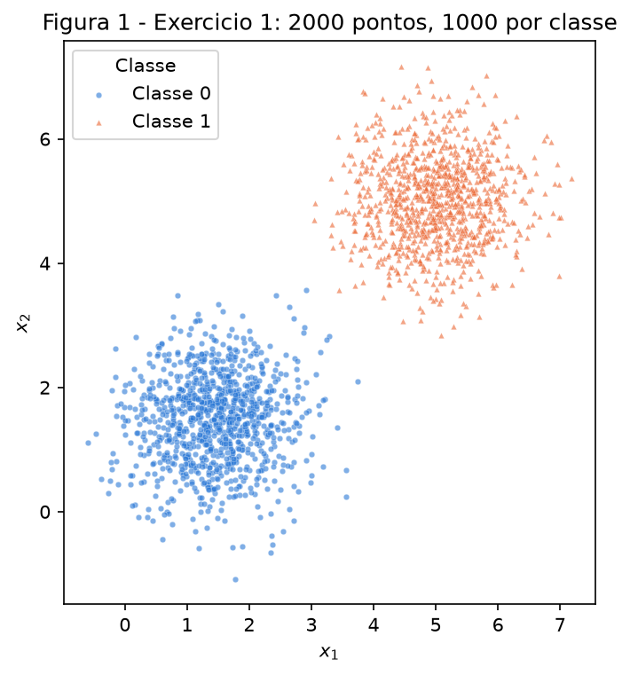
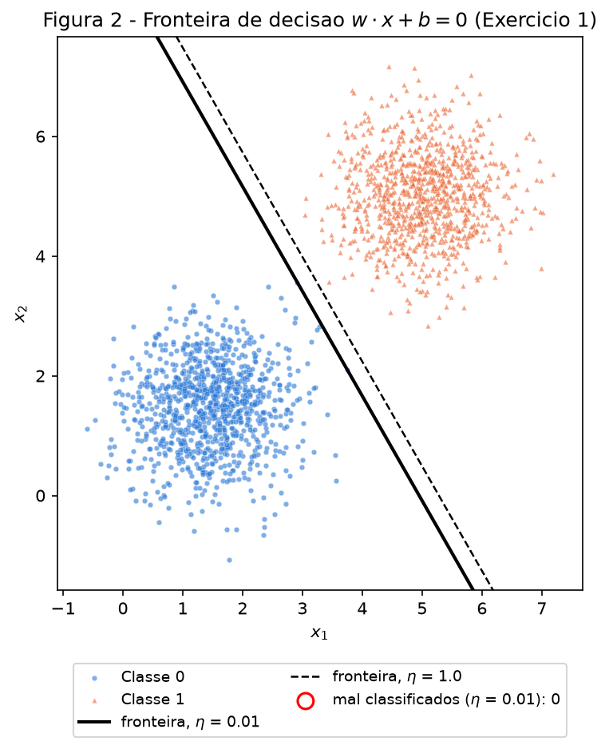
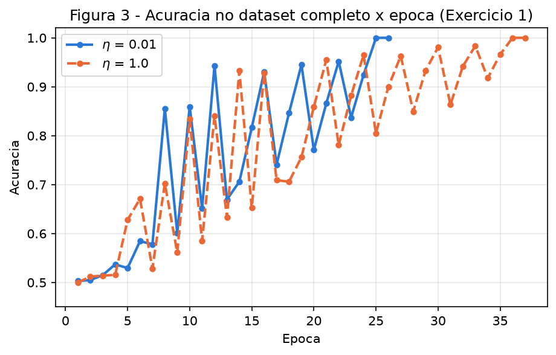
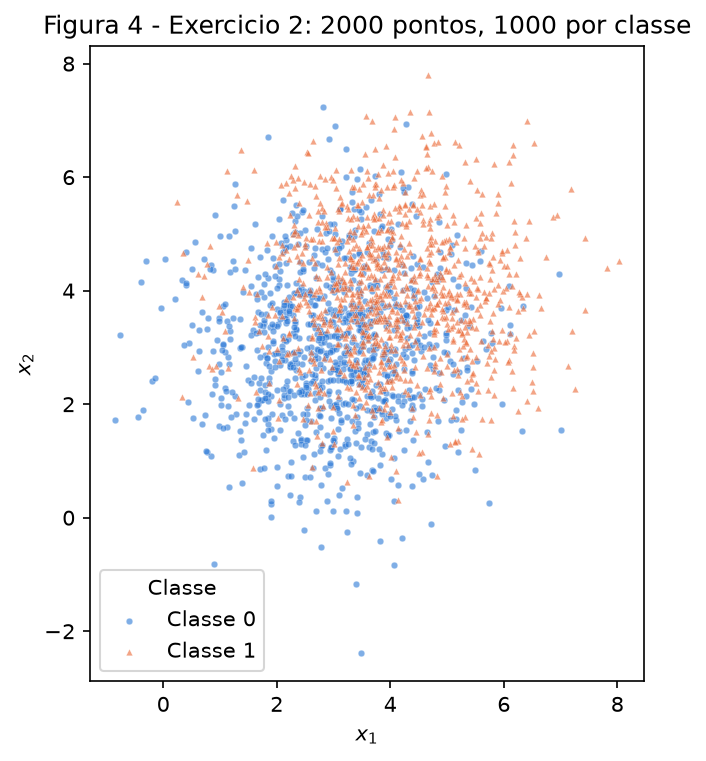
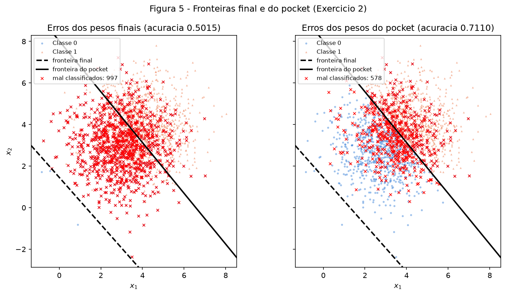
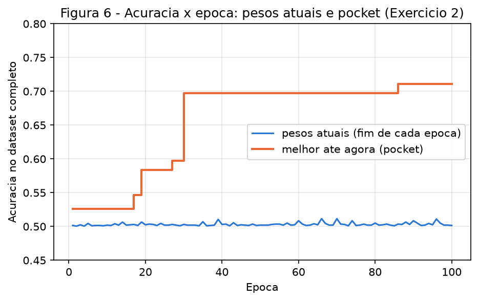

# 2. Perceptron

!!! abstract "Enunciado"

    [Exercises → Perceptron](https://insper.github.io/ann-dl/){:target='_blank'} — edição 2026.2.

Todo o código está em [`code/`](https://github.com/lucasnov/neural-networks-and-deep-learning/tree/main/docs/exercises/perceptron/code)
e entra neste relatório direto dos arquivos. Só uso NumPy (dados e perceptron) e
matplotlib (figuras). Nenhuma biblioteca fornece o modelo. Para regenerar tudo, a partir
da raiz do repositório:

``` shell
python docs/exercises/perceptron/code/run_all.py
```

O comando leva poucos segundos, recria as seis figuras e imprime a tabela de "Resumo dos
resultados" do fim da página. Rodei duas vezes e as saídas foram idênticas.

**Abordagem.** O perceptron fica num arquivo só, `perceptron.py`, com quatro funções
pequenas: `step`, `predict`, `accuracy` e `train`. Os dois exercícios chamam a mesma `train`.
Algumas decisões que tomei:

- **Um único gerador.** O enunciado pede o mesmo `rng = np.random.default_rng(42)` no
  relatório todo. O `run_all.py` cria esse `rng` uma vez e o usa em sequência: dados do
  Exercício 1, `w` inicial do Exercício 1, dados do Exercício 2, `w` inicial do
  Exercício 2. Como o Exercício 2 continua o mesmo gerador, o script dele, quando roda
  sozinho, refaz antes os sorteios do Exercício 1 (sem treinar) para chegar ao mesmo
  ponto. Conferi que o resultado sai igual.
- **Ordem das amostras.** Cada dataset é gerado com a Classe 0 primeiro e a Classe 1
  depois, e o treino percorre as amostras nessa ordem, sem embaralhar, porque o enunciado
  não pede embaralhamento. Na minha primeira versão eu embaralhava os pontos ao gerar, e os
  pesos finais do Exercício 2 mudaram bastante. Esse foi o principal desafio: perceber que,
  num perceptron que nunca para de atualizar, os pesos "finais" dependem de quais amostras
  vieram por último. Voltei à forma literal do enunciado e expliquei a dinâmica nos itens D.
- **Pocket desde o início.** Para o Exercício 2 reutilizar o Exercício 1 sem mudar nada, o
  rastreio do pocket já está dentro de `train` desde o Exercício 1. A cada atualização mede
  a acurácia no dataset inteiro e, se ela for a maior já vista, copia `(w, b)`. No
  Exercício 1 isso não altera nada, porque o treino termina com 100%.
- **Rótulos.** Uso $\{0, 1\}$ e a regra dirigida pelo erro $(y - \hat y)$, como o enunciado
  manda, e não a forma $\mathbf w \leftarrow \mathbf w + \eta\,y\,\mathbf x$ de rótulos $\pm1$.

``` { .python .select linenums='1' title="docs/exercises/perceptron/code/common.py" }
--8<-- "docs/exercises/perceptron/code/common.py"
```

---

## Exercício 1

### A — Gere os dados

Gerei 1000 pontos por classe com `rng.multivariate_normal`, usando os parâmetros do
enunciado:

| Classe | Média | Covariância |
|--------|-------|-------------|
| 0 | $[1.5,\ 1.5]$ | $\begin{bmatrix} 0.5 & 0 \\ 0 & 0.5 \end{bmatrix}$ |
| 1 | $[5,\ 5]$ | $\begin{bmatrix} 0.5 & 0 \\ 0 & 0.5 \end{bmatrix}$ |

Ao todo são 2000 pontos: `X` tem formato (2000, 2) e `y` tem formato (2000,), com
1000 pontos de cada classe.


/// caption
**Figura 1** — As duas classes do Exercício 1. As nuvens ficam bem afastadas em relação
ao espalhamento (desvio $\sqrt{0.5} \approx 0.71$ em cada eixo, centros a 4.95 de
distância), com um vão vazio entre elas.
///

### B — Implemente o perceptron

- **Predição:** $\hat y = \text{degrau}(\mathbf w \cdot \mathbf x + b)$, com degrau$(z) = 1$
  se $z \ge 0$ e $0$ caso contrário.
- **Atualização, amostra por amostra:** $\mathbf w \leftarrow \mathbf w + \eta(y - \hat y)\mathbf x$
  e $b \leftarrow b + \eta(y - \hat y)$. O erro $(y - \hat y)$ vale 0 quando o ponto está certo,
  então só quem erra move a reta:
    - um falso negativo ($y = 1$, $\hat y = 0$) **soma** $\eta\mathbf x$ a $\mathbf w$ e $\eta$ a $b$;
    - um falso positivo ($y = 0$, $\hat y = 1$) **subtrai** $\eta\mathbf x$ de $\mathbf w$ e $\eta$ de $b$.
- **Inicialização:** `w = rng.normal(0, 0.01, size=2)`, que sorteou
  $\mathbf w_0 = [0.0025,\ 0.0090]$, e $b = 0$.
- **Taxa de aprendizado:** $\eta = 0.01$.
- **Parada:** a primeira de duas condições. Uma época inteira sem nenhuma atualização
  (convergiu) ou 100 épocas.
- **Registro:** a acurácia no dataset completo ao fim de cada época.

``` { .python .select linenums='1' title="docs/exercises/perceptron/code/perceptron.py" }
--8<-- "docs/exercises/perceptron/code/perceptron.py"
```

### C — Treine e meça

| Item | $\eta = 0.01$ |
|------|---------------|
| $\mathbf w$ final | $[0.0505,\ 0.0289]$ |
| $b$ final | $-0.2500$ |
| Épocas | **26** (25 com atualizações + 1 época limpa, que confirma a convergência) |
| Atualizações no total | 73 |
| Acurácia final | **1.0000** (0 pontos mal classificados) |

A fronteira é a reta $0.0505\,x_1 + 0.0289\,x_2 - 0.25 = 0$.


/// caption
**Figura 2** — Fronteira $\mathbf w \cdot \mathbf x + b = 0$ com $\eta = 0.01$ (linha cheia).
Pontos mal classificados seriam circulados em vermelho, mas não há nenhum. A linha
tracejada é a fronteira da re-execução com $\eta = 1.0$ (item D). As duas separam as
classes, mas não são a mesma reta.
///


/// caption
**Figura 3** — Acurácia no dataset completo ao fim de cada época, para $\eta = 0.01$ e
$\eta = 1.0$. As duas curvas sobem em zigue-zague e chegam a 1.0, onde o treino para.
///

``` { .python .select linenums='1' title="docs/exercises/perceptron/code/exercise1_separable.py" }
--8<-- "docs/exercises/perceptron/code/exercise1_separable.py"
```

### D — Análise

**Por que converge, e rápido.** Os dados são linearmente separáveis com folga: existe uma
reta (várias, na verdade) que deixa todos os pontos da Classe 0 de um lado e todos os da
Classe 1 do outro, com um vão entre as nuvens. O teorema de convergência do perceptron
garante que, nesse caso, o número total de erros (e de atualizações) é finito. O motivo é
que cada atualização gira $(\mathbf w, b)$ um pouco na direção de uma reta separadora.
Aqui foram só **73 atualizações** em $26 \times 2000 = 52\,000$ visitas a amostras.

A regra também explica por que uma época limpa encerra o treino. Se nenhuma amostra gerou
atualização, então $(\mathbf w, b)$ classifica todas as 2000 corretamente. Na época
seguinte nada mudaria, porque cada amostra produz $y - \hat y = 0$, e os pesos ficam
parados para sempre. É um ponto fixo, e a acurácia é exatamente 1.0.

**O que acontece com as atualizações por época.** Os números reais com $\eta = 0.01$:

```
época:         1  2  3  4  5  6  7  8  9 10 11 12 13 14 15 16 17 18 19 20 21 22 23 24 25 26
atualizações:  3  3  4  4  3  4  3  4  2  4  2  4  2  3  3  3  2  3  3  2  3  3  2  3  1  0
```

O número de atualizações por época **não cai aos poucos**. Fica entre 2 e 4 por quase todo
o treino e despenca para 1 e depois 0 no fim. Olhando quais amostras geram atualização, dá
para ver o porquê: são quase sempre as primeiras de cada bloco (índices 0 e 1 da Classe 0,
índice 1000 da Classe 1). Como as amostras vêm em blocos por classe, cada época é um cabo de
guerra. O fim do bloco da Classe 1 deixa a reta "a favor" da Classe 1, então os primeiros
pontos da Classe 0 da época seguinte erram e empurram a reta de volta, e assim por diante.
É também por isso que a acurácia da Figura 3 sobe em zigue-zague.

O que faz o treino avançar é o bias. Foram 49 atualizações vindas da Classe 0 ($b$ desce
0.01 cada) e 24 da Classe 1 ($b$ sobe 0.01 cada). Em termos líquidos, $b$ desce 0.01 por
época: $-0.01, -0.02, -0.04, \dots, -0.25$. Enquanto isso, cada erro move $\mathbf w$ de
$0.01\,\lVert\mathbf x\rVert$, que é cerca de 5 vezes mais. A reta só cai no vão entre as
nuvens quando $b$ chega a cerca de $-4.3\,\lVert\mathbf w\rVert$ (no final,
$b/\lVert\mathbf w\rVert = -0.25/0.0582 = -4.30$), e isso leva 25 épocas. Ou seja: a
convergência é rápida no sentido de poucos erros no total, e cada época cheia de acertos
não gera nenhuma atualização.

**Re-execução com $\eta = 1.0$.** Mesmos dados, mesmo $\mathbf w_0$, mesmo $b = 0$, só
muda $\eta$:

| | $\eta = 0.01$ | $\eta = 1.0$ |
|---|---|---|
| $\mathbf w$ final | $[0.0505,\ 0.0289]$ | $[5.8706,\ 3.3592]$ |
| $b$ final | $-0.2500$ | $-31.0000$ |
| Épocas | 26 | **37** |
| Acurácia final | 1.0000 | **1.0000** |
| Direção $\mathbf w/\lVert\mathbf w\rVert$ | $[0.8681,\ 0.4963]$ | $[0.8679,\ 0.4967]$ |
| $b/\lVert\mathbf w\rVert$ | $-4.2979$ | $-4.5832$ |

As duas chegam a 100%. As direções de $\mathbf w$ são praticamente iguais (ângulo de
0.020° entre elas), mas o bias normalizado é diferente. Então as fronteiras são **retas
quase paralelas, deslocadas uma da outra em 0.29 unidades** (Figura 2, linha cheia ×
tracejada). Não são a mesma fronteira, e o treino levou um número diferente de épocas.

**O que $\eta$ controla.** Partindo de $\mathbf w_0$, depois de $t$ atualizações:

$$
\mathbf w_t = \mathbf w_0 + \eta \sum_{k \le t} e_k\,\mathbf x_k,
\qquad b_t = \eta \sum_{k \le t} e_k,
\qquad e_k = y_k - \hat y_k \in \{-1, +1\}.
$$

A predição só depende do sinal de $\mathbf w_t \cdot \mathbf x + b_t$, e dividir tudo por
$\eta > 0$ não muda o sinal. Então o perceptron se comporta como se tivesse começado em
$\mathbf w_0/\eta$ e desse passos de tamanho 1. **O $\eta$ define o peso da inicialização
diante das atualizações**: é o tamanho do passo em relação aos pesos iniciais.

- Com $\eta = 0.01$: $\mathbf w_0/\eta = [0.25,\ 0.90]$, comparável a um passo
  ($\lVert\mathbf x\rVert \approx 4.7$ em média). A inicialização ainda influencia as
  primeiras decisões, e a trajetória é uma.
- Com $\eta = 1.0$: $\mathbf w_0/\eta = [0.0025,\ 0.0090]$, desprezível diante de passos
  de tamanho ~5. O treino praticamente esquece o $\mathbf w_0$. De fato, o resultado com
  $\eta = 1.0$ ($[5.8706,\ 3.3592]$, $b = -31$, 37 épocas) é quase igual ao de partir do zero
  (abaixo: $[5.8681,\ 3.3503]$, $b = -31$, 37 épocas).

Trajetórias diferentes geram sequências de erros diferentes e param na primeira reta que
separa os dados, que é uma reta diferente em cada caso.

**Partindo de $\mathbf w = \mathbf 0$, $b = 0$, o $\eta$ não teria efeito nenhum.** Escrevo
$\boldsymbol\theta = (\mathbf w, b)$ e $\tilde{\mathbf x} = (\mathbf x, 1)$, de modo que
$\mathbf w \cdot \mathbf x + b = \boldsymbol\theta \cdot \tilde{\mathbf x}$ e a regra vira
$\boldsymbol\theta \leftarrow \boldsymbol\theta + \eta\,e\,\tilde{\mathbf x}$.

Sejam duas execuções com $\eta_1, \eta_2 > 0$, as duas começando em
$\boldsymbol\theta_0 = \mathbf 0$ e visitando as amostras na mesma ordem. Afirmo que, depois
de cada amostra $t$:

$$
\boldsymbol\theta^{(2)}_t = \frac{\eta_2}{\eta_1}\,\boldsymbol\theta^{(1)}_t .
$$

*Por indução.*

- **Base:** $\boldsymbol\theta^{(2)}_0 = \mathbf 0 = \frac{\eta_2}{\eta_1}\mathbf 0$.
- **Passo:** suponha que vale em $t$, e seja $c = \eta_2/\eta_1 > 0$.
    - As predições na amostra seguinte são iguais:
      $\hat y^{(2)} = \text{degrau}(c\,\boldsymbol\theta^{(1)}_t \cdot \tilde{\mathbf x}) = \text{degrau}(\boldsymbol\theta^{(1)}_t \cdot \tilde{\mathbf x}) = \hat y^{(1)}$.
      Multiplicar por $c > 0$ não muda o sinal, e $c \cdot 0 = 0$ continua $\ge 0$.
    - Logo o erro $e = y - \hat y$ é o mesmo nas duas execuções, e
      $\boldsymbol\theta^{(2)}_{t+1} = c\,\boldsymbol\theta^{(1)}_t + \eta_2\,e\,\tilde{\mathbf x} = c\,(\boldsymbol\theta^{(1)}_t + \eta_1\,e\,\tilde{\mathbf x}) = c\,\boldsymbol\theta^{(1)}_{t+1}$.

Consequências:

1. As duas execuções erram exatamente **nas mesmas amostras, na mesma ordem**. Então têm o
   mesmo número de atualizações em cada época e param **na mesma época**.
2. A fronteira $\{\mathbf x : \boldsymbol\theta \cdot \tilde{\mathbf x} = 0\}$ não muda quando
   $\boldsymbol\theta$ é multiplicado por $c > 0$. É **a mesma reta**.
3. Só a escala dos pesos muda, pelo fator $\eta_2/\eta_1$.

A prova quebra justamente quando $\boldsymbol\theta_0 \ne \mathbf 0$: a base vira
$\boldsymbol\theta^{(2)}_0 = \boldsymbol\theta^{(1)}_0 \ne c\,\boldsymbol\theta^{(1)}_0$. É
por isso que o enunciado proíbe a partida do zero. Conferi numericamente (o script imprime):

| Partindo de $\mathbf 0$ | $\mathbf w$ final | $b$ final | Épocas |
|---|---|---|---|
| $\eta = 0.01$ | $[0.0587,\ 0.0335]$ | $-0.31$ | 37 |
| $\eta = 1.0$ | $[5.8681,\ 3.3503]$ | $-31.00$ | 37 |

A razão entre as duas é exatamente 100 nas três componentes, e a lista de amostras que
geraram atualização é idêntica.

---

## Exercício 2

### A — Gere os dados

Mesmo gerador, continuando a sequência do `rng` depois do Exercício 1, com os parâmetros
do enunciado:

| Classe | Média | Covariância |
|--------|-------|-------------|
| 0 | $[3,\ 3]$ | $\begin{bmatrix} 1.5 & 0 \\ 0 & 1.5 \end{bmatrix}$ |
| 1 | $[4,\ 4]$ | $\begin{bmatrix} 1.5 & 0 \\ 0 & 1.5 \end{bmatrix}$ |

São 2000 pontos, 1000 por classe, com `X` de formato (2000, 2). A norma média dos pontos é
$\lVert\mathbf x\rVert \approx 5.11$.


/// caption
**Figura 4** — As duas classes do Exercício 2. Os centros ficam a só $\sqrt 2 \approx 1.41$
um do outro, e o desvio é $\sqrt{1.5} \approx 1.22$ em cada eixo. As nuvens se sobrepõem
em boa parte da área.
///

### B — Treine guardando os melhores pesos

Chamei a mesma `train` do Exercício 1, sem mudar nenhuma linha. Usei $\eta = 0.01$, no
máximo 100 épocas, $\mathbf w_0 = [0.0122,\ -0.0045]$ sorteado pelo `rng` e $b = 0$. O
treino **não convergiu**: usou as 100 épocas, com 2 a 5 atualizações em todas elas
(289 no total).

| | $\mathbf w$ | $b$ | Acurácia (dataset completo) |
|---|---|---|---|
| **Pesos finais** (fim da época 100) | $[0.0545,\ 0.0480]$ | $-0.0700$ | **0.5015** |
| **Pesos do pocket** (melhor já visto) | $[0.0107,\ 0.0087]$ | $-0.0700$ | **0.7110** |

A melhor configuração do pocket apareceu durante a **época 86**.

``` { .python .select linenums='1' title="docs/exercises/perceptron/code/exercise2_overlap.py" }
--8<-- "docs/exercises/perceptron/code/exercise2_overlap.py"
```

### C — Figuras


/// caption
**Figura 5** — As duas fronteiras: final (tracejada) e pocket (cheia). Nos dois painéis os
erros aparecem marcados com `x` vermelho. À esquerda estão os erros dos pesos finais
(997 pontos, quase toda a Classe 0); à direita, os do pocket (578 pontos, concentrados na
faixa onde as nuvens se misturam).
///


/// caption
**Figura 6** — Acurácia no dataset completo ao fim de cada época, para os pesos atuais
(azul) e para o pocket (laranja). Os pesos atuais ficam colados em 50% nas 100 épocas. O
pocket sobe em degraus até 0.7110 na época 86.
///

### D — Análise

**Por que os pesos finais vão tão mal e o pocket não.** A posição da fronteira não depende
de $\mathbf w$ e $b$ separadamente, e sim da razão entre eles. Sobre a diagonal
$x_1 = x_2 = t$, a reta $w_1x_1 + w_2x_2 + b = 0$ passa em $t = -b/(w_1 + w_2)$. O centro dos
dados está em $t = 3.5$, e é por ali que passa a melhor reta, $x_1 + x_2 = 7$. Essa
referência geométrica (sem treino nenhum) acerta **0.7125** destes pontos, perto dos ~73%
citados no enunciado.

- **Pesos finais:** $t = 0.07/(0.0545 + 0.0480) = 0.68$. A reta passa perto da origem,
  abaixo e à esquerda de praticamente toda a nuvem (Figura 5, tracejada). Quase todos os
  pontos ficam do lado da Classe 1: os pesos finais preveem Classe 1 para 99.85% dos
  pontos, o que dá os 0.5015 de acurácia, um chute.
- **Pocket:** $t = 0.07/(0.0107 + 0.0087) = 3.61$. A reta corta a nuvem no meio, quase
  em cima da referência, e acerta 0.7110.

Os dois têm **o mesmo $b = -0.07$**. A diferença está toda no tamanho de $\mathbf w$.

**Por que o laço deixa a fronteira perto da origem.** Pela regra de atualização, cada erro
move $b$ de $\eta = 0.01$, mas move $\mathbf w$ de $\eta\lVert\mathbf x\rVert \approx 0.05$,
cerca de 5 vezes mais. Para a reta ficar em $t \approx 3.5$, $b$ teria de ser
$\approx -3.5\,(w_1 + w_2)$, bem maior em módulo que os componentes de $\mathbf w$. Mas $b$
quase não anda, porque os erros se alternam entre as classes. A primeira amostra da
Classe 0 (índice 0) e a primeira da Classe 1 (índice 1000) erraram em **todas** as
100 épocas: uma desce $b$ em 0.01, a outra sobe de volta. No total foram 148 erros da
Classe 0 e 141 da Classe 1, então $b$ terminou em $-0.01 \times (148 - 141) = -0.07$. Nas
100 épocas, $b$ ficou sempre entre $-0.08$ e $-0.01$, enquanto $\lVert\mathbf w\rVert$
variou entre 0.042 e 0.082. Com $b \approx -0.07$ e $\lVert\mathbf w\rVert$ dessa ordem, a
reta fica perto da origem.

Além disso, cada época termina com o bloco da Classe 1, e as últimas correções empurram a
reta para "prever Classe 1". Por isso a acurácia ao fim de **todas** as 100 épocas ficou
entre 0.5005 e 0.5115.

O pocket funciona porque mede a acurácia **a cada atualização**, e não só ao fim da época.
No meio de uma época há momentos, logo depois de uma correção, em que
$\lVert\mathbf w\rVert$ fica pequeno ($0.0138$ no pocket) enquanto $b$ continua em $-0.07$.
Nesses momentos $-b/\lVert\mathbf w\rVert$ fica grande, e a reta cai no meio da nuvem. O laço
passa por essa configuração e segue em frente, mas o pocket guarda a cópia.

**Figura 3 × Figura 6.** No Exercício 1 a acurácia chega a 1.0, a época seguinte não tem
erro e o treino para. Aqui a curva dos pesos atuais nunca estabiliza nem sobe, e o laço
nunca para: toda época tem erros, então toda época tem atualizações.

O teorema de convergência do perceptron (Novikoff) diz o seguinte. **Se** existe
$(\mathbf w^*, b^*)$ que classifica todos os pontos corretamente com uma margem $\gamma > 0$,
e os pontos têm norma limitada por $R$, então o perceptron faz no máximo $(R/\gamma)^2$
erros e para. A hipótese que este dataset viola é a da **separabilidade linear**.

As nuvens se sobrepõem (Figura 4), então não existe reta com 100% de acerto: a reta de
referência erra 28.75% dos pontos, e o melhor estado visitado em todo o treino (o pocket)
erra 28.90%. Sem uma reta separadora, não há $\gamma > 0$ e o limite de erros
não existe. O teorema não promete nada. A garantia é sobre convergência para uma solução
perfeita, e não sobre achar a melhor reta possível quando a perfeita não existe.

**Mais épocas resolvem? Não.** Para o laço parar, seria preciso uma época inteira sem erros,
ou seja, uma reta que acerte os 2000 pontos, e ela não existe. Como o pocket é medido a
cada atualização, ele mostra que nenhum $(\mathbf w, b)$ visitado no treino errou menos de
28.90% dos pontos. Toda época gera novas atualizações, e o estado nunca vira um ponto fixo. A Figura 6 mostra o mesmo padrão da época 1 à 100. Mais
épocas só repetiriam essa oscilação. Também não dá para esperar que os pesos finais
melhorem: eles são sempre o estado deixado pelas últimas correções, do bloco da Classe 1.

**Um $\eta$ menor resolve? Também não.** Pela regra, $\eta$ multiplica igualmente o passo de
$\mathbf w$ ($\eta\,e\,\mathbf x$) e o de $b$ ($\eta\,e$). Então:

1. A razão entre o quanto $b$ anda e o quanto $\mathbf w$ anda por erro continua sendo
   $1 : \lVert\mathbf x\rVert \approx 1 : 5$. O desequilíbrio que deixa a reta perto da origem
   não depende de $\eta$.
2. Pelo argumento de escala do Exercício 1, $\eta$ só muda o tamanho dos pesos em relação ao
   $\mathbf w_0$, não quais pontos ficam de cada lado de cada reta possível. A partir do zero,
   qualquer $\eta$ produz exatamente a mesma sequência de erros.
3. A sobreposição é uma propriedade dos dados, não do treino. Nenhum valor de $\eta$ cria
   uma reta com 100% de acerto onde ela não existe.

Um $\eta$ menor só faria a mesma oscilação com passos menores. O que melhora o resultado é
mudar o que se guarda (o pocket) ou o modelo (uma fronteira não linear, ou um modelo que
minimize uma perda suave), não o tamanho do passo.

---

## Resumo dos resultados

| # | Quantidade | Valor |
|---|------------|-------|
| 1 | Exercício 1 — $\mathbf{w}$ e $b$ finais | $\mathbf w = [0.0505,\ 0.0289]$, $b = -0.2500$ |
| 2 | Exercício 1 — épocas até convergir | 26 (25 com atualizações + 1 época sem atualização) |
| 3 | Exercício 1 — acurácia final | 1.0000 |
| 4 | Exercício 1 — épocas e acurácia final com $\eta = 1.0$ | 37 épocas, acurácia 1.0000 |
| 5 | Exercício 2 — $\mathbf{w}$ e $b$ finais | $\mathbf w = [0.0545,\ 0.0480]$, $b = -0.0700$ |
| 6 | Exercício 2 — acurácia dos pesos finais | 0.5015 |
| 7 | Exercício 2 — acurácia dos pesos do pocket | 0.7110 ($\mathbf w = [0.0107,\ 0.0087]$, $b = -0.0700$) |
| 8 | Exercício 2 — época em que o melhor do pocket ocorreu | 86 |
